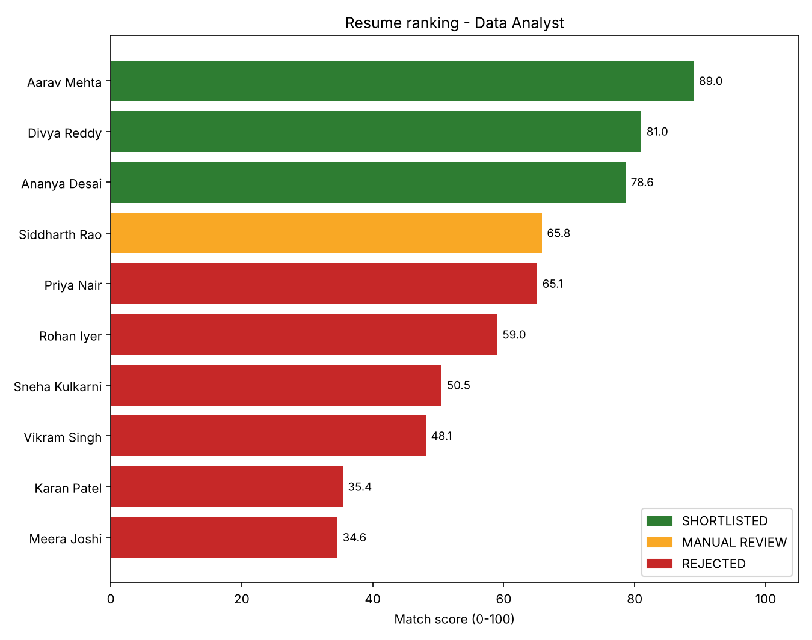
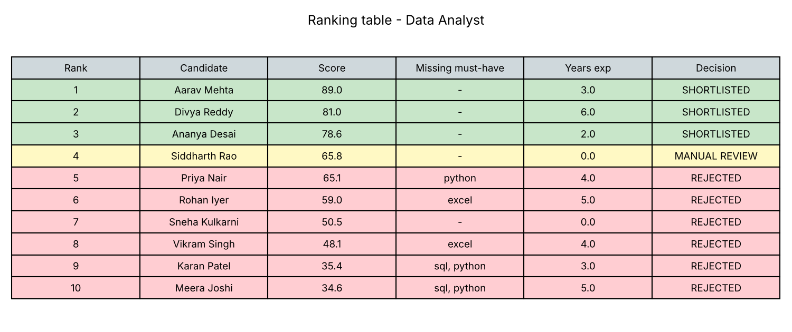

# Automated Resume Screening Tool

A Python NLP project that reads resumes (PDF / DOCX / TXT), compares them with a job description, **scores and ranks candidates**, flags missing must-have skills, and produces CSV reports with plain-English explanations.

> Built with **synthetic (fictional) resumes** because real company ATS data is not available. No real personal data is used.



## Problem Statement
Recruiters receive hundreds of resumes per opening. Reading each one is slow and inconsistent. This tool automates first-round screening so HR can focus on the best-matching candidates.

## Industry Relevance
ATS and HR-tech platforms use skills extraction, text similarity and rule gates (must-have skills, minimum experience) to build shortlists. This project reproduces that idea end-to-end and is relevant to Python Developer, Data Analyst, Automation and AI/NLP roles.

## Features
- Text extraction from **PDF, DOCX and TXT** resumes
- Text cleaning with **contact-detail redaction** (e-mails / phones never affect the score)
- **Skill matching** with a curated skills dictionary and aliases (e.g. `mysql` counts as SQL)
- **Experience extraction** from statements like "3 years of experience"
- **TF-IDF + cosine similarity** between job description and resume
- **Transparent 0-100 score** (weights are editable) and automatic ranking
- **Must-have gap detection** - candidates missing a must-have are never auto-shortlisted
- **Keyword-stuffing detection** - suspicious resumes go to MANUAL REVIEW instead of being auto-decided
- CSV reports + chart; optional **Streamlit dashboard** and **FastAPI** service

## Tech Stack
Python 3.9+, Pandas, NumPy, scikit-learn (TF-IDF, cosine similarity), pdfplumber / pypdf, python-docx, Regex, Matplotlib. Optional: Streamlit, FastAPI + Uvicorn. Tests: pytest.

## How the Score Works
```
score = 100 x ( 0.30 x text_similarity      # TF-IDF cosine, scaled
              + 0.40 x must_have_coverage    # share of must-have skills found
              + 0.10 x nice_to_have_coverage
              + 0.20 x experience_score )    # min(1, years / required years)
```
| Decision | Rule |
|---|---|
| SHORTLISTED | score >= threshold (60) **and** all must-have skills found **and** no stuffing flag |
| MANUAL REVIEW | possible keyword stuffing - a human should check |
| REJECTED | everything else |

All values live in `data/job_config.json` and `src/scorer.py`.

## Folder Structure
```
Automated-Resume-Screening-Tool/
├── resumes/            # sample resumes (10 synthetic PDF/DOCX/TXT)
├── data/               # job_description.txt + job_config.json
├── src/                # extractor, cleaner, skills, scorer, report, generate_samples
├── api/                # optional FastAPI service
├── tests/              # automated tests
├── outputs/            # generated CSV reports + terminal output
├── images/             # chart / table images and screenshots
├── docs/               # explanation, plan, simulation, GitHub steps, interview prep
├── app_streamlit.py    # optional dashboard
├── main.py             # run the full pipeline
├── requirements.txt
├── .gitignore
└── README.md
```

## How to Run
```bash
# 1. create & activate a virtual environment
python -m venv venv
venv\Scripts\activate          # Windows
source venv/bin/activate       # Mac / Linux

# 2. install
pip install -r requirements.txt

# 3. (optional) regenerate sample resumes
python -m src.generate_samples

# 4. run screening
python main.py

# 5. optional extras
streamlit run app_streamlit.py
uvicorn api.app:app --reload          # then open http://127.0.0.1:8000/docs
python -m pytest
```

## Sample Output (Data Analyst job)
| Rank | Candidate | Score | Missing must-have | Years | Decision |
|---|---|---|---|---|---|
| 1 | Aarav Mehta | 89.0 | - | 3 | SHORTLISTED |
| 2 | Divya Reddy | 81.0 | - | 6 | SHORTLISTED |
| 3 | Ananya Desai | 78.6 | - | 2 | SHORTLISTED |
| 4 | Siddharth Rao | 65.8 | - | 0 | MANUAL REVIEW (keyword stuffing) |
| 5 | Priya Nair | 65.1 | python | 4 | REJECTED |
| 6 | Rohan Iyer | 59.0 | excel | 5 | REJECTED |
| 7 | Sneha Kulkarni | 50.5 | - | 0 | REJECTED |
| 8 | Vikram Singh | 48.1 | excel | 4 | REJECTED |
| 9 | Karan Patel | 35.4 | sql, python | 3 | REJECTED |
| 10 | Meera Joshi | 34.6 | sql, python | 5 | REJECTED |

Full files: `outputs/ranking_report.csv`, `outputs/shortlisted_candidates.csv`, `outputs/rejected_candidates.csv`.

## Screenshots
| Ranking table | Score chart |
|---|---|
|  |  |

*(Add your own terminal / Streamlit screenshots to `images/` and link them here.)*

## Limitations (honest)
- Skills come from a fixed dictionary - unknown skills are ignored.
- Experience is read only from explicit statements ("3 years of experience"), not from date ranges.
- Scanned (image-only) PDFs need OCR, which is not included.
- TF-IDF matches words, not meaning (no semantic understanding).
- Screening is decision *support*: a human must make the final hiring decision.

## Fairness and Privacy
Contact details are removed before scoring; name, gender, age, religion or location are never used as features; every decision has a written reason; borderline or suspicious cases go to manual review.

## Future Improvements
Sentence-transformer embeddings (semantic matching), spaCy NER, OCR for scanned PDFs, date-range experience parsing, SQLite storage, Next.js recruiter dashboard, Docker deployment.

## Learning Outcomes
File handling (PDF/DOCX), regex and text cleaning, TF-IDF and cosine similarity, feature engineering and explainable scoring, Pandas reporting, modular code, testing, FastAPI / Streamlit basics, Git and GitHub workflow, responsible-AI thinking in hiring.
